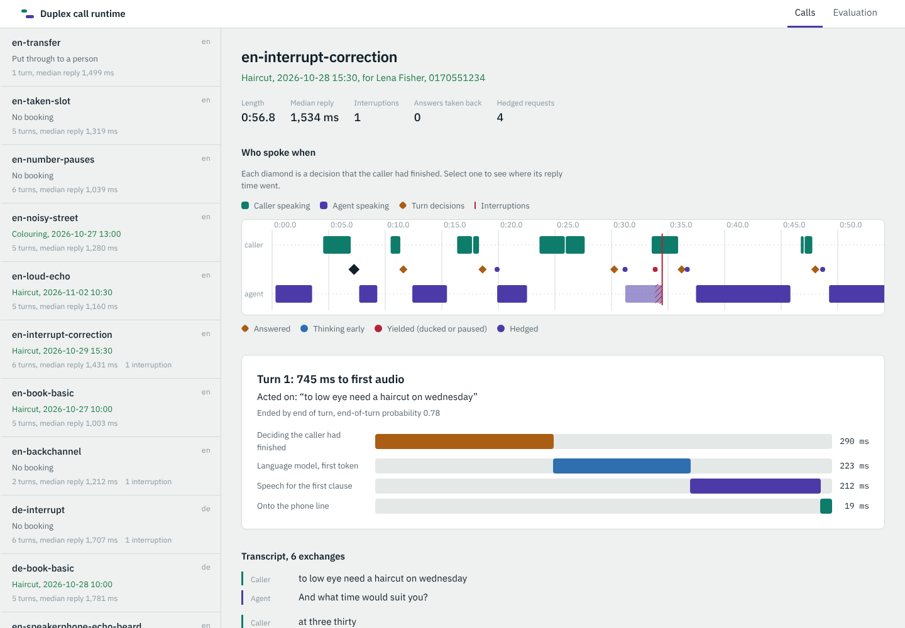
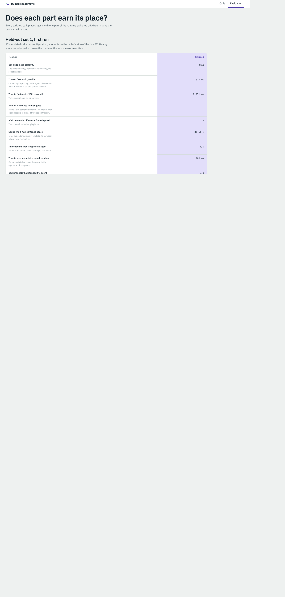
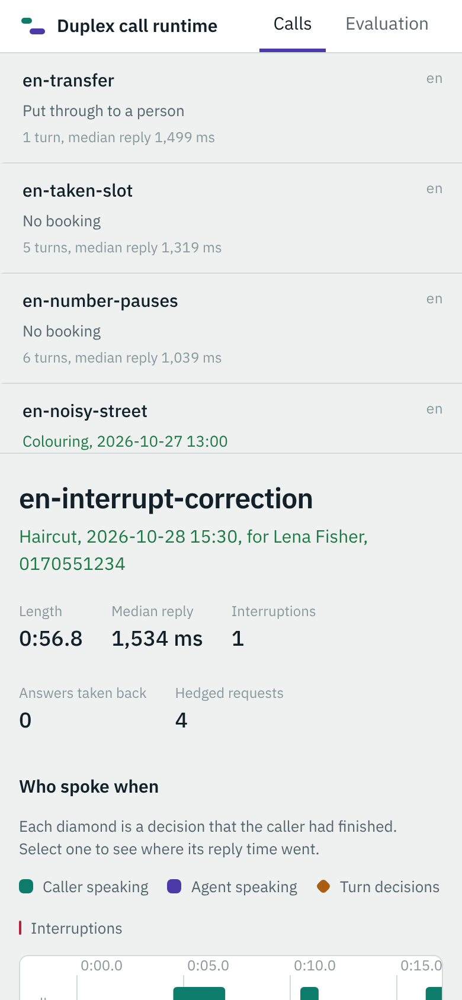

# duplex-call-runtime

A voice agent that answers real phone calls. Twilio Media Streams in; streaming speech
recognition; an LLM with tools, streamed and hedged across providers; streaming speech
synthesis out. All of it runs in one asyncio runtime. The hard part of a phone agent is not any one model but the
conversation: knowing when the caller has finished, starting to think before being sure, taking
a wrong guess back, stopping when interrupted, talking on through "mhm", and never mistaking
its own echo for the caller. This repository does those things and measures each one from the
caller's side of the line.

The agent here is Mira, the receptionist of a hair salon, in English and German: she books
appointments, checks the calendar, answers questions and puts callers through to a person.



## How a call flows

```
Twilio ──ws /media──▶ mu-law 8 kHz ─▶ echo canceller ─▶ 16 kHz ─▶ VAD ─┬─▶ streaming STT (batched, own thread)
   ▲                    (ref: what we played, matched by frame count)   │        │
   │                                                                    │        ▼
   │                                                  barge-in: ignore / duck / interrupt     end of turn?
   │                                                                    │        │  (words + what we asked)
   │                                                                    │   120 ms: speculate ──▶ LLM router
   │                                                                    │   200 ms+: commit         (hedge 450 ms,
   └──── 20 ms pacer ◀── mu-law ◀── TTS per clause ◀── text stream ◀────┘                         breaker, stall)
                                                         │
                                                    tools: check availability (any time),
                                                           book / transfer (committed turns only)
```

- **Telephony** (docs/adr/0001): Twilio's Media Streams protocol over one WebSocket per call:
  `media`, `mark` and `clear`, and the TwiML webhook behind Twilio's request signature. G.711 is
  written by hand. Outbound audio is paced at real time, so `clear` and ducking take effect within
  40 ms.
- **Echo** (docs/adr/0001, 0003): a partitioned-block frequency-domain adaptive filter, with a
  double-talk freeze and residual suppression. Its reference is matched by frame count, not
  arrival time. A near-end gate keeps loud, unconverged echo from counting as the caller.
- **End of turn** (docs/adr/0002): a small model reads the transcript and what the agent last
  asked. Rules hold the turn open through a half-dictated phone number. The LLM starts
  speculatively at 120 ms of pause; from 200 ms the agent may answer. A reply that the caller
  talks over before hearing it is taken back silently.
- **Barge-in** (docs/adr/0003): under 300 ms, ignore; "mhm", "yeah" or "genau", keep talking;
  two words or a stop word ("no", "wait", "nein"), stop. Anything else ducks the agent 14 dB until
  it is clear. On an interruption the history keeps only the words the caller actually heard.
- **Providers** (docs/adr/0004): any OpenAI-compatible endpoint. A request with no token after
  450 ms is hedged to the next provider. A circuit breaker and a stall detector cover the rest.
  A booking or transfer never runs on a speculative reply.
- **Serving** (docs/adr/0005): one batched streaming recogniser per process, off the event loop.
  German uses Whisper per pause. Prometheus metrics are at `/metrics`; vLLM and the runtime have
  Kubernetes manifests in `deploy/k8s/`.

## Results

Every number below comes from simulated phone calls scored from the caller's side of the line.
Caller speech is synthesised. The line adds echo, noise and G.711. Agent speech is found by
energy in what the carrier played. The metrics follow Full-Duplex-Bench (pause handling,
backchannels, smooth turn-taking, user interruption) plus time to first audio. All of it ran on
2 CPU cores, with every component sharing them.

### Held-out calls, written blind

Two sets of 12 calls were written by someone who saw only `calls/WRITING_CALLS.md`, never the
code. Each set's first run is recorded once and never rewritten (`reports/heldout/`). Set 1's
failures were then studied, so it is now a regression set; set 2 was written and run after that.

| | Set 1, first run | Set 2, first run |
|---|---:|---:|
| Agent spoke into a caller's mid-sentence pause | 0 of 6 lines | 0 of 7 lines |
| "mhm" / "yeah" / "genau" that stopped the agent | 0 of 3 | 0 of 5 |
| Agent stopped with the caller silent (echo, noise) | 0 | 0 |
| Interruptions that stopped the agent within 1.5 s | 1 of 1 | 2 of 2 |
| Time to first audio, median / 90th percentile | 1,517 / 2,271 ms | 1,580 / 2,435 ms |
| Calls that ended with exactly the expected booking or transfer | 4 of 12 | 5 of 12 |
| Transcript word error rate | 27% | 34% |

The turn-taking held on calls nobody tuned for. The task numbers did not: 7 of 16 English and 2 of
8 German calls came out right. In set 1 and the dev calls, every failure traced to recognition or
to the stand-in LLM, not to turn-taking (set 2 has not been studied). The recogniser merges
repeated digits, loses first words and misreads names, and German on Whisper base is worse still. The deterministic stand-in for the LLM misses phrasings
a real model would understand. Studying set 1 (before set 2 was written) found two runtime
bugs, both now fixed and tested: flushing the recogniser inside a dictated number damaged its
digits, and a number given without "my number is" kept the turn open for 2.6 s.

### What each part buys (dev calls, one part off at a time)

`reports/EVAL_DEV.md`: 10 calls per configuration; differences with 95% bootstrap intervals.

| Configuration | Time to first audio, median | vs shipped | Stops with caller silent | Interruption: audio stops | Backchannels that stopped it |
|---|---:|---:|---:|---:|---:|
| **Shipped** | 1,485 ms | | 0 | 880 ms (ducked from ~310 ms) | 0 of 1 |
| Silence endpointing (answer after 800 ms) | 1,824 ms | **+339 ms** [+69, +446] | 0 | 950 ms | 0 of 1 |
| No speculation | 1,675 ms | +189 ms [-302, +376] | 0 | 900 ms | 0 of 1 |
| No echo cancelling | 1,435 ms | -50 ms [-412, +212] | **19** | 1,030 ms | 0 of 1 |
| No hedging | 1,483 ms | -2 ms [-333, +170] | 0 | 950 ms | 0 of 1 |
| Pause instead of duck | 1,355 ms | -130 ms [-395, +206] | 0 | **470 ms** | **1 of 1** |

- **Reading the words beats waiting for silence**: 339 ms off the median reply, an interval
  well clear of zero, with no extra cut-ins into pauses.
- **Echo cancelling is what makes the line usable**: without it the agent stopped 19 times for
  its own voice, and the transcript error rate rose from 22% to 38%.
- **Hedging works on the tail, where it should**: the LLM's first token at the 99th percentile
  fell from 1,818 ms to 959 ms, and the slowest from 2,053 ms to 1,048 ms. The median did not
  move (docs/MEASUREMENTS.md). The dev set has too few slow requests to show it in reply times.
- **Ducking against pausing is a real trade-off**: pausing stops the audio sooner (470 against
  880 ms), but it also stopped for a "mhm". Ducking yields 14 dB within about 310 ms and stops
  fully once words arrive. Ducking ships.
- **Speculation is not proven here**: it starts the LLM only 80 ms before the answer point, and
  the interval includes zero.

### Serving and components

| | |
|---|---|
| Streaming recogniser, 8 calls batched vs one at a time | 5.7 vs 3.4 calls per CPU core |
| Turn decision's wait for the transcript, 4 live calls | 64 ms batched vs 585 ms unbatched (median) |
| End-of-turn model | AUC 0.89 on unseen turns; 36 µs per decision |
| Echo canceller, converged | more than 15 dB of echo removed; caller passes with less than 2 dB loss in double talk |
| German recogniser per pause (Whisper base, speech span only) | 36% WER on phone-band German, 407 ms per utterance |

Method and tables: docs/MEASUREMENTS.md.

## Run it

```bash
python -m venv .venv && . .venv/bin/activate
pip install -e ".[dev]"
dcr fetch                       # pinned models (SHA-256 in config/assets.yaml), about 1 GB
pytest -q                       # 57 tests, including two whole simulated calls in real time (19 more in web/)
dcr eval --configs full         # the dev calls; reports/EVAL_DEV.md
cd web && npm ci && npm test && npm run build && cd ..
dcr serve                       # the runtime and the console at http://127.0.0.1:8000
```

Or `docker compose up` for the runtime with two simulated LLM providers (no API key needed).

To take real calls, point a Twilio number's voice webhook at `https://<host>/twilio/voice`
(add `?lang=de` for German). Set `TWILIO_AUTH_TOKEN` and `DCR_PUBLIC_URL`, and list your LLM
providers in `DCR_SETTINGS_OVERRIDE` (see `.env.example`).

| Command | What it does |
|---|---|
| `dcr serve` | the runtime: `/twilio/voice`, `/media`, `/metrics`, the console and its API |
| `dcr call calls/dev/en-book-basic.yaml` | place one simulated call and print its event log |
| `dcr eval [--configs full,...]` | every dev call under every configuration (ablations) |
| `dcr heldout <set>` | the first and only recorded run of a held-out set |
| `dcr bench` | serving benchmark: recogniser throughput by batch, sync lag, TTS first audio |
| `dcr train-turn` | retrain the end-of-turn model and print its validation numbers |
| `dcr sim-provider` | a simulated OpenAI-compatible provider with a slow tail and fault injection |

## The console

`web/` is the operator's view of the calls (React, TypeScript, Framer Motion). Each call shows
as two lanes, caller above and agent below, with every decision between them: turn ends,
speculation, take-backs, ducks, interruptions and hedged requests. Selecting a turn opens where
its reply time went: endpointing, the model's first token, speech and playout. The evaluation
page sets every configuration against every measure. Every screen has loading, error-with-retry
and empty states; motion is one draw-in of the timeline and a spring on the latency bars, both off
under reduced motion. It works on a phone and in dark mode.

 

## Honest limits

- **No GPU and no real LLM here.** Everything was measured on 2 CPU cores. The LLM is a
  deterministic stand-in (`llm/brain.py`) behind a simulated OpenAI-compatible server with a
  realistic time to first token, an 8% slow tail, errors and stalls. It makes calls reproducible
  and free, but it understands far less than a real model. Many task failures are its failures:
  the runtime's turn-taking and latency are what these calls measure best.
- **Synthetic callers.** Caller speech is Piper TTS through a simulated phone line, not people.
  Recognition errors on it are real errors of the models, but real callers differ: accents,
  disfluency, louder rooms.
- **Latency is CPU-bound.** The caller, the line, recognition, synthesis and both providers
  share two cores, so the absolute numbers are higher than on a serving machine. The
  differences between configurations are the point.
- **German is the weak language.** Whisper base per pause misreads phone-band German often
  (36% WER on the dev lines; see docs/MEASUREMENTS.md), and waiting for it adds about 400 ms to
  every German turn. A streaming German model is the fix.
- **Repeated digits** ("four four four") are merged by the recogniser often enough to fail
  bookings. The agent reads the number back; a scripted caller cannot correct it.
- The GPU deployment (`deploy/k8s/`) is written and validated as YAML, not run.
